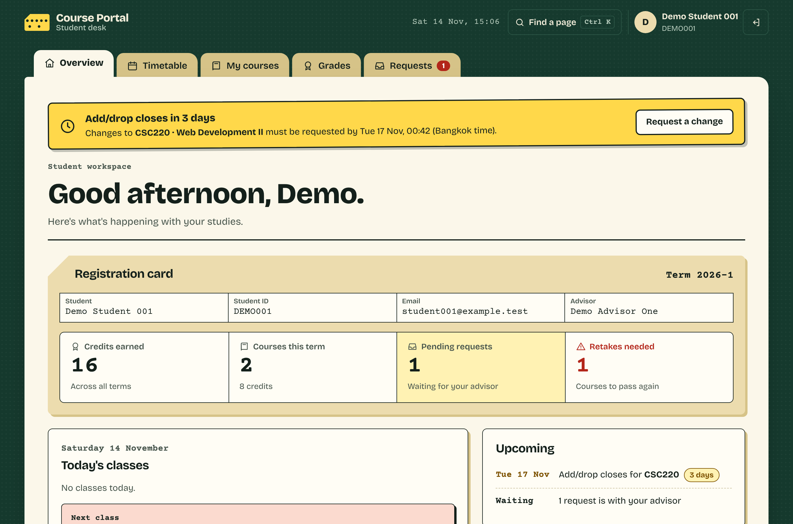
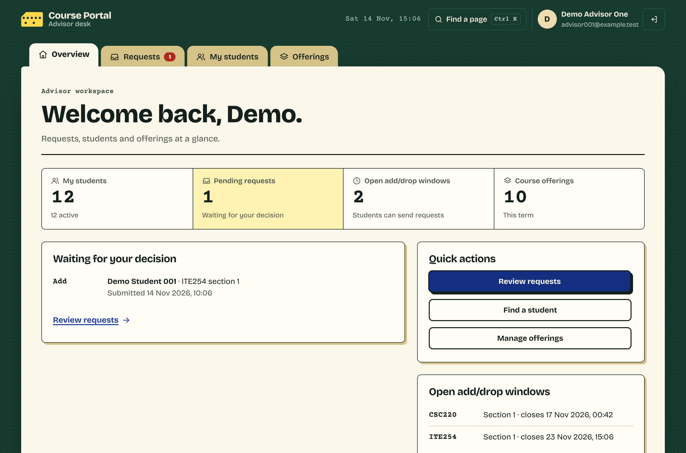
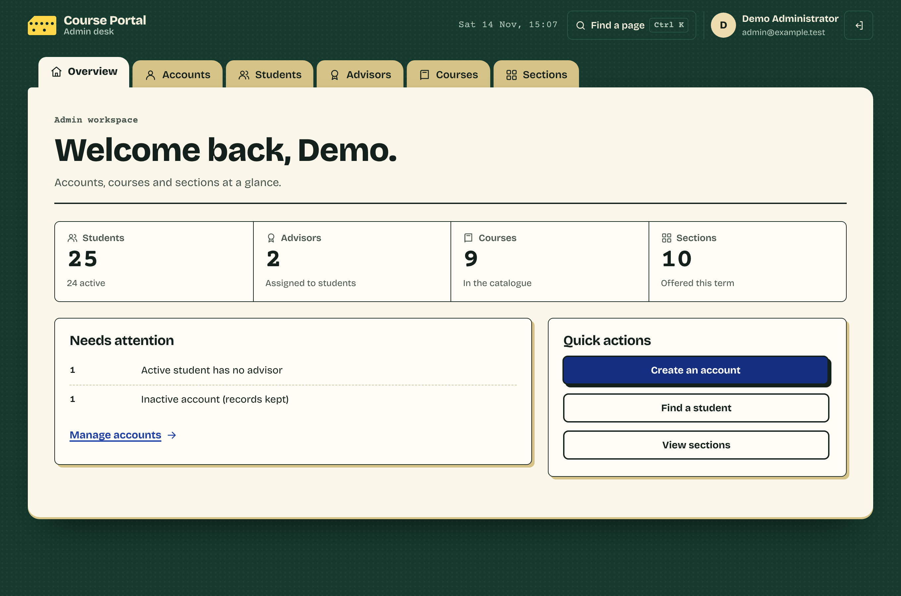

<div align="center">

# Course Portal

**A course registration portal for students, academic advisors and administrators.**

Built with React, Express and MongoDB. It has a "registrar's desk" interface, a weekly timetable and Add/Drop requests that advisors approve inside the app.

[](https://github.com/MohanBro/course-registration-side-project/actions/workflows/ci.yml)


[](LICENSE)



</div>

> [!NOTE]
> This is a personal continuation by Sham Bahadu of a team course project (see [Attribution](#attribution)). It runs locally for development only. It is **not deployed** and **not ready for real student records**.

## Contents

- [Features](#features)
- [Screenshots](#screenshots)
- [Tech stack](#tech-stack)
- [Getting started](#getting-started)
- [Demo accounts](#demo-accounts)
- [Testing](#testing)
- [Project structure](#project-structure)
- [Documentation](#documentation)
- [Roadmap](#roadmap)
- [Contributing workflow](#contributing-workflow)
- [Attribution](#attribution)
- [License](#license)

## Features

### Students
- **Overview**: today's classes, the next class, upcoming deadlines, credits earned and retakes needed.
- **Weekly timetable** with Week and List views. It handles classes that meet more than once a week, weekend classes, missing schedules and overlapping older meetings (shown side by side). You can export it to Google Calendar, Apple Calendar or Outlook as an `.ics` file.
- **My courses** as punch cards, where the punched holes show when each class meets.
- **Grades** by term, with coloured grade badges and credit totals.
- **Add/Drop requests**: submit a request with a reason, cancel a pending one and read the advisor's decision. A banner warns when an add/drop window is about to close.

### Advisors
- **Request inbox** with a pending count. Approving a request rechecks every registration rule and updates the registration in one atomic, repeat-safe step.
- **My students**: grade history, current registrations, and eligible offerings with the reason when one is blocked. Advisors can register or drop students directly.
- **Offerings**: create, edit and remove sections (schedule, room, instructor, capacity), see remaining seats, and open or close each add/drop window.

### Administrators
- **Accounts**: create, edit, search, deactivate and assign advisors. Safeguards stop the last active admin from being removed.
- **Courses and sections** overview.

### Accounts and security
- **Password recovery** through a "Forgot your password?" link and a single-use reset link that expires after 30 minutes. Only a hash of each link is stored, and requests are rate-limited per computer and per email address.
- The reply is the same whether or not an email is registered. Only active accounts receive a link.
- Changing or resetting a password **signs that user out of every existing session**. When a signed-in request is refused, the app returns to the sign-in page with a short notice.

### Interface and accessibility
- One "registrar's desk" design: manila folder tabs (a bottom bar on phones), punch-card courses, carbon-copy request slips and rubber-stamp decisions.
- **Ctrl+K / ⌘K** jumps to any page. Confirmations use an in-page dialog instead of browser pop-ups.
- Keyboard focus is always visible, animations stop when the device asks for reduced motion, and every page has its own title.
- Fonts (Bricolage Grotesque and Courier Prime, SIL OFL) are stored in the repository, so the app loads nothing from other websites.

## Screenshots

| Student | Advisor | Admin |
|---|---|---|
|  |  |  |

All screenshots use fictional demo data.

## Tech stack

| Layer | Tools |
|---|---|
| Frontend | React 19, React Router 7, Vite 8, Oxlint |
| Backend | Node.js 24, Express 5, Mongoose 9, JSON Web Tokens, bcrypt |
| Database | MongoDB Atlas |
| Tests and CI | Node's built-in test runner, GitHub Actions |

## Getting started

### Prerequisites

- **Node.js 24** (the version CI uses) and npm
- A **MongoDB Atlas** cluster with a new, empty database for this project

### 1. Install

```bash
git clone https://github.com/MohanBro/course-registration-side-project.git
cd course-registration-side-project
npm ci --prefix server
npm ci --prefix client
```

### 2. Configure the backend

```bash
cp server/.env.example server/.env
```

| Variable | Purpose |
|---|---|
| `PORT` | API port (default `5002`) |
| `CLIENT_ORIGIN` | Frontend address allowed by CORS (default `http://localhost:5174`) |
| `MONGODB_URI` | Your own Atlas connection string |
| `MONGODB_DB_NAME` | A separate personal database name. The demo seed only accepts `course_registration_seed_personal_dev` |
| `JWT_SECRET` | A new, long random secret |
| `SEED_PASSWORD` | Shared password for the demo accounts |
| `MAIL_TRANSPORT` | `console` prints password-reset emails in the backend terminal (development only). `memory` is for tests. Leave it empty to send no email. No real email provider is set up yet |
| `APP_BASE_URL` | Optional: website address used in reset links (defaults to `CLIENT_ORIGIN`) |
| `DNS_SERVERS` | Optional: comma-separated DNS servers, for networks that cannot resolve Atlas addresses |
| `SEED_FILE` | Optional: workbook for the inherited `npm run seed` script (not used by the demo seed) |

> [!WARNING]
> Never commit `server/.env`, and never reuse the original team's database or secrets.

### 3. Load demo data (optional)

```bash
npm run demo:preview --prefix server   # shows what would be created, without connecting
npm run demo:seed --prefix server      # fills a NEW, EMPTY database with fictional data
```

The seed only runs when `MONGODB_DB_NAME` is `course_registration_seed_personal_dev`, and it refuses to run on a database that already has data. See [demo data](docs/demo-data.md) for every scenario it sets up.

### 4. Run

Use two terminals:

```bash
cd server && npm run dev          # API → http://localhost:5002/api
npm run dev --prefix client       # Web → http://localhost:5174
```

Start the backend from inside `server/`, because it reads `.env` from that folder. Then open **http://localhost:5174**.

## Demo accounts

After `demo:seed`, every active account signs in with your `SEED_PASSWORD`:

| Account | Role | Scenario |
|---|---|---|
| `admin@example.test` | Admin | The only admin, so last-admin safeguards apply |
| `advisor001@example.test` | Advisor | Advises DEMO001–DEMO013 |
| `advisor002@example.test` | Advisor | Advises DEMO014–DEMO025 |
| `student001@example.test` | Student | Active registrations and varied eligibility cases |
| `student002@example.test` | Student | Passed a course they had failed; fills the only THA101 seat |
| `student004@example.test` | Student | Dropped STA101 earlier and can register again |
| `student025@example.test` | Student | Inactive account, so sign-in fails |

Demo addresses end in `.test` and cannot receive real email. To test password recovery, read the reset link in the backend terminal (`MAIL_TRANSPORT=console`).

## Testing

**Offline checks** (no database needed). GitHub Actions runs these on every push to `main` or `feature/**` and on every pull request to `main`:

```bash
npm test --prefix server          # 63 backend tests
npm test --prefix client          # 20 frontend tests: timetable, punch cards, dashboard, calendar, password form
npm run lint --prefix client
npm run build --prefix client
```

**Live Atlas checks.** Each one creates a temporary database, runs the real server against it and then deletes it. Your demo database is not touched.

```bash
npm run test:requests:integration --prefix server   # Add/Drop requests
npm run test:sessions:integration --prefix server   # a password change ends old sessions
npm run test:reset:integration --prefix server      # password reset flow
```

> [!CAUTION]
> The older inherited `test:integration` script keeps its test database afterwards. Read `server/scripts/acceptance.mjs` before running it.

## Project structure

```
.
├── client/                 React + Vite frontend
│   ├── public/fonts/       Fonts stored in the repository
│   ├── src/
│   │   ├── components/     App shell, timetable, punch cards, request slips…
│   │   ├── pages/          Student, advisor, admin and auth pages
│   │   ├── styles/         Shared portal styles
│   │   └── utils/          Timetable, calendar export, dashboard helpers
│   └── tests/              Frontend unit tests
├── server/                 Express API
│   ├── src/
│   │   ├── controllers/    Route handlers
│   │   ├── models/         Mongoose models
│   │   ├── routes/         /api/auth, /student, /advisor, /admin, /health
│   │   └── utils/          Registration rules, auth, mailer, rate limits
│   ├── scripts/            Demo seed and live integration checks
│   └── tests/              Backend unit tests
├── docs/                   Guides, roadmap, diagrams and screenshots
└── .github/workflows/      CI
```

## Documentation

| Guide | What it covers |
|---|---|
| [Development roadmap](docs/development-roadmap.md) | Milestones and feature decisions |
| [In-app requests](docs/in-app-requests.md) | Add/Drop request workflow and tests |
| [Demo data](docs/demo-data.md) | Demo accounts and scenarios |
| [Learning milestone 1](docs/learning-milestone-1.md) | How the timetable works |
| [Database diagram](docs/database-diagram.svg) | Collections and relationships |
| [Server README](server/README.md) | Backend scripts, API routes and folders |
| [Client README](client/README.md) | Frontend scripts and folders |
| [Original group README](docs/original-group-readme.md) | The team's submitted project |

## Roadmap

- [x] Interface foundation and weekly timetable
- [x] Personal repository and fictional demo data
- [x] Add/Drop requests inside the app
- [x] Password recovery
- [x] Student workspace, unified app shell and "registrar's desk" theme
- [ ] Public release readiness: real email provider, hosting, accessibility checks in CI, and a production readiness review

## Contributing workflow

- `origin` is this repository. `upstream` is the original team repository; it is kept for reference and pushing to it is disabled.
- New work goes on `feature/...` branches and is merged into `main` through pull requests.
- Local `main` still tracks `upstream/main`, so update it from this repository explicitly:

  ```bash
  git checkout main
  git pull --ff-only origin main
  ```

- The app uses ports `5174` and `5002`, which differ from the team project's ports, so sign-ins in the browser stay separate.

## Attribution

The original Course Registration System was built by **Rachaphon Bhetcharut, Sham Bahadu, Panruethai Thubthimthong, Hathairat Deesrisuk and Trithep Sik**. The original repository is [Captansleepy/ITE220-Final-Project-Course-Registration-System](https://github.com/Captansleepy/ITE220-Final-Project-Course-Registration-System), and its Git history is preserved here. The redesign and the later features are personal additions. They are described separately, so the inherited application is not presented as solo work.

> [!IMPORTANT]
> The inherited workbook `server/CSC220-Project-Info_final_1.xlsx` is still in the repository, and its first 17 histories were reported to be based on real academic records. The demo seed does not read it.

## License

Released under the [MIT License](LICENSE). Copyright (c) 2026 the original team: Rachaphon Bhetcharut, Sham Bahadu, Panruethai Thubthimthong, Hathairat Deesrisuk and Trithep Sik.
